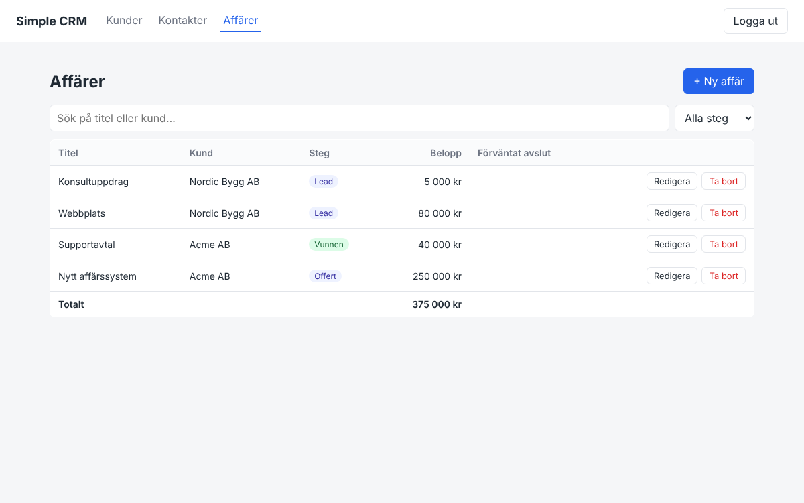

# Simple CRM

Ett enkelt CRM-system (Customer Relationship Management) byggt som ett lärprojekt.
Här kan du hantera **kunder**, deras **kontaktpersoner** och **affärer**, med sökning och inloggning.



## Teknik

| Del | Teknik |
| --- | --- |
| Backend | .NET 10, ASP.NET Core Web API (controllers) |
| Databas | SQL Server 2022 i Docker, Entity Framework Core (code first + migrations) |
| Inloggning | JWT (JSON Web Token), lösenord hashas med `PasswordHasher` från ASP.NET Identity |
| Frontend | React 19 + Vite + TypeScript, React Router |

## Funktioner

- Kunder: lista, sök, skapa, redigera, ta bort
- Kontakter: kopplade till en kund, med sökning
- Affärer: belopp, steg (Lead → Kontaktad → Offert → Vunnen/Förlorad), förväntat avslutsdatum, filtrering på steg
- Inloggning och registrering, alla CRM-endpoints kräver inloggning
- Testdata och en demo-användare skapas automatiskt första gången

## Kom igång

### Det här behöver du

- [.NET 10 SDK](https://dotnet.microsoft.com/download)
- [Node.js](https://nodejs.org/) 20 eller senare
- [Docker Desktop](https://www.docker.com/products/docker-desktop/)
- Valfritt: SQL Server Management Studio (SSMS) eller Azure Data Studio för att titta i databasen

### 1. Starta databasen

Från projektets rotmapp:

```bash
docker compose up -d
```

Det startar SQL Server på `localhost,1433` med användaren `sa` och lösenordet `Your_strong_Passw0rd`.
Första gången tar det en liten stund innan databasen är redo.

### 2. Starta backenden

```bash
cd backend/SimpleCrm.Api
dotnet run
```

API:t kör nu på http://localhost:5000. Vid start körs EF Core-migrations automatiskt,
så databasen `SimpleCrm` och tabellerna skapas av sig själva, och testdata läggs in.

### 3. Starta frontenden

Öppna en ny terminal:

```bash
cd frontend
npm install
npm run dev
```

Gå till http://localhost:5173 och logga in med demo-användaren:

- E-post: `demo@crm.se`
- Lösenord: `Demo123!`

## Projektstruktur

```
simple-crm/
├── docker-compose.yml          SQL Server i Docker
├── backend/
│   ├── SimpleCrm.slnx          Solution-fil (öppna i Visual Studio / Rider)
│   └── SimpleCrm.Api/
│       ├── Controllers/        API-endpoints (Customers, Contacts, Deals, Auth)
│       ├── Data/               CrmDbContext och testdata (SeedData)
│       ├── Dtos/               Det som skickas in/ut via API:t
│       ├── Migrations/         Genererade av EF Core, beskriver databasens tabeller
│       ├── Models/             Entiteter = tabeller i databasen
│       ├── Services/           TokenService som skapar JWT
│       ├── Program.cs          Startpunkt: konfiguration av tjänster och pipeline
│       └── SimpleCrm.Api.http  Färdiga testanrop mot API:t
└── frontend/
    └── src/
        ├── api.ts              Alla anrop till backenden
        ├── types.ts            TypeScript-typer som matchar backendens DTO:er
        ├── App.tsx             Meny och routing
        └── pages/              En sida per del: Login, Kunder, Kontakter, Affärer
```

## API

Alla endpoints utom `/api/auth/*` kräver headern `Authorization: Bearer <token>`.

| Metod | Adress | Beskrivning |
| --- | --- | --- |
| POST | `/api/auth/register` | Skapa konto, returnerar token |
| POST | `/api/auth/login` | Logga in, returnerar token |
| GET | `/api/customers?search=` | Lista/sök kunder |
| GET | `/api/customers/{id}` | Hämta en kund |
| POST | `/api/customers` | Skapa kund |
| PUT | `/api/customers/{id}` | Uppdatera kund |
| DELETE | `/api/customers/{id}` | Ta bort kund (och dess kontakter och affärer) |
| GET | `/api/contacts?search=&customerId=` | Lista/sök kontakter |
| GET/POST/PUT/DELETE | `/api/contacts/{id}` | Som för kunder |
| GET | `/api/deals?search=&stage=&customerId=` | Lista/sök affärer, `stage` är t.ex. `Won` |
| GET/POST/PUT/DELETE | `/api/deals/{id}` | Som för kunder |

Det enklaste sättet att testa är filen `backend/SimpleCrm.Api/SimpleCrm.Api.http`, som går att köra direkt i
Visual Studio, Rider eller VS Code (med tillägget REST Client).
OpenAPI-beskrivningen finns på http://localhost:5000/openapi/v1.json.

## Ändra databasen (migrations)

När du ändrar en klass i `Models/` behöver databasen uppdateras med en ny migration:

```bash
dotnet tool install --global dotnet-ef   # bara första gången
cd backend/SimpleCrm.Api
dotnet ef migrations add BeskrivandeNamn
```

Nästa gång du kör `dotnet run` uppdateras databasen automatiskt.

## Titta i databasen med SSMS

Anslut med:

- Server: `localhost,1433`
- Autentisering: SQL Server Authentication
- Login: `sa`, lösenord: `Your_strong_Passw0rd`
- Kryssa i "Trust server certificate"

## Vanliga problem

- **Backenden kraschar vid start med ett anslutningsfel:** databasen har inte startat klart. Vänta några sekunder och kör `dotnet run` igen. Kolla med `docker compose ps`.
- **Port 1433 är upptagen:** du har redan en SQL Server igång lokalt. Stoppa den, eller ändra porten i `docker-compose.yml` och i `appsettings.json`.
- **Börja om med tom databas:** `docker compose down -v` tar bort containern och all data. Kör sedan `docker compose up -d` igen.

## Säkerhet

Lösenordet till databasen och JWT-nyckeln i `appsettings.json` är bara till för lokal utveckling.
I ett riktigt projekt läggs de i [User Secrets](https://learn.microsoft.com/aspnet/core/security/app-secrets)
eller miljövariabler och checkas aldrig in i Git.

## Idéer på vad du kan bygga vidare med

- Detaljsida för en kund som visar dess kontakter och affärer
- Paginering av listorna
- Enhetstester med xUnit för controllers
- Dashboard med summor per affärssteg
- Roller (t.ex. admin och säljare)
